# Normalizing Flows for optimal transport and background validation in HH → 4b

Optimal transport of QCD-multijet events from off-mass Validation Regions (VRs) to the Signal Region (SR) of the
CMS HH → 4b analysis, using a Conditional Normalizing Flow (CNF). Data: CMS 2022, 34.7 fb⁻¹ at √s = 13.6 TeV.

---

## 1. Physics problem

Non-resonant ggF HH production gives direct access to the Higgs self-coupling κ_λ = λ/λ_SM. In the 4b final state,
the dominant background is QCD multijet production, which simulation models poorly (S/B ≈ 10⁻⁴ after selection).
It is therefore estimated from data: a DNN learns the 2b → 4b transfer factor (a likelihood ratio) in the control
region (CR, R_HH ∈ (30, 55) GeV in the m_H1–m_H2 plane), and is then applied to the 2b-tagged SR (R_HH < 30 GeV)
to predict the 4b SR.

To **validate** this estimate, five signal-free off-mass regions (VR₁…VR₅) are defined in both 2b and 4b, each with
its own SR-like and CR-like annulus. The catch: the m_H1–m_H2 selection itself changes the event kinematics, so a VR is
not a faithful proxy of the SR.

<p align="center">
  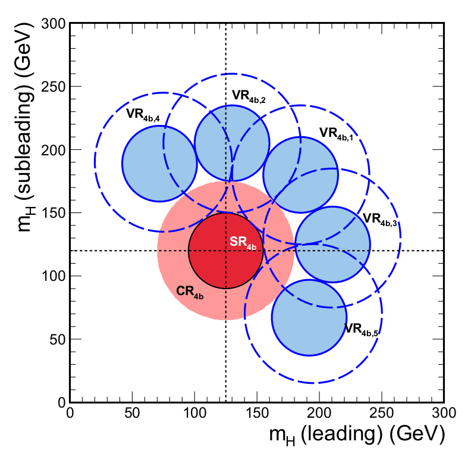<br>
  <em>SR, CR and the five off-mass VRs in the m_H1–m_H2 plane.</em>
</p>

**Goal:** build a multidimensional optimal transport (OT) that morphs each VR into the SR, so the background
method can be tested on SR-like kinematics without unblinding:

1. train the OT on 2b data, VR₁²ᵇ → ŜR²ᵇ;
2. apply the same OT, unchanged, to 4b data, VR₁⁴ᵇ → ŜR⁴ᵇ;
3. apply the 2b → 4b reweighting to ŜR²ᵇ, obtaining S̃R⁴ᵇ, and compare it with ŜR⁴ᵇ (and with the true SR⁴ᵇ).

<p align="center">
  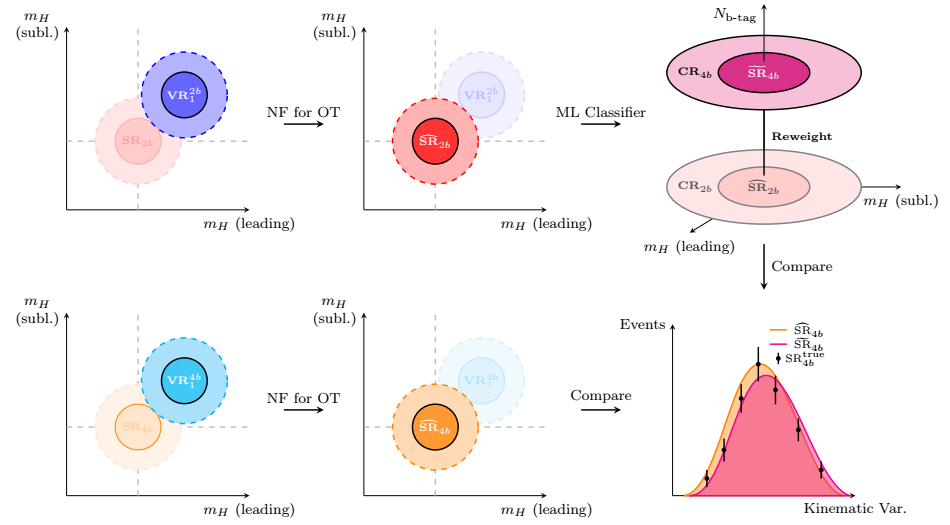<br>
  <em>Optimal transport strategy.</em>
</p>

---

## 2. Conditional Normalizing Flow

A normalizing flow is a learnable diffeomorphism g between a simple base density p_u and the data density,
p_x(x) = p_u(g⁻¹(x)) |det J_{g⁻¹}|. Conditioning g on a region label c lets a single network learn p(x | c) for every
region with shared weights. The transport goes through the shared latent space:
encode with c = VRᵢ, decode with c = SR.

```
u = g⁻¹(x | c = VRᵢ)        x̂ = g(u | c = SR)
```

<p align="center">
  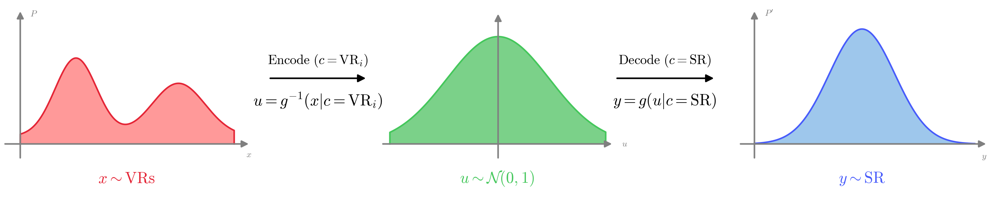<br>
  <em>1D picture of the VR → SR transport through the latent space.</em>
</p>

---

## 3. Network structure

### Input features

The flow sees only low-level quantities: the four-vectors (p_T, η, φ, m) of the four jets forming the Higgs
candidates, plus H_T, which carries the global hadronic activity. That gives **17 features**, or **21** in the 5-jet
model. Every high-level feature (H₁, H₂, the HH system, ΔR_jj, min/max ΔR_jj, helicity angles, |cos θ*_CS|, 5th-jet
cross features) is rebuilt from the transported jets with four-vector algebra and **is never seen by the network**.
The closure of these features is therefore a direct test of whether the flow learned the correct correlations.

### Feature preprocessing

The rational-quadratic splines are defined on [−5, 5] and are the identity outside it, so every input must be mapped
into that box:

- energetic variables (p_T, m, H_T): `x → ln(1 + x)`, to make the steeply falling spectra closer to Gaussian;
- all variables: scikit-learn `RobustScaler` (median / IQR, robust to the high-energy tails), then clipping.

<p align="center">
  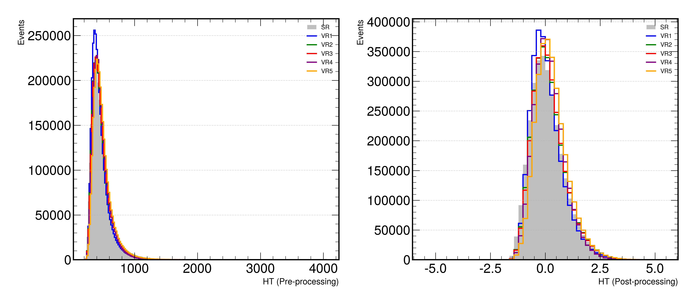<br>
  <em>H_T before (left) and after (right) the preprocessing.</em>
</p>

### Periodic features

φ is flat with hard edges at ±π. A standard Neural Spline Flow (NSF) does not know that the two edges are the same
point, and has to stretch them towards the tails of a Gaussian. The four φ's are therefore modeled by a
**Neural Circular Spline Flow (NCSF)** with a uniform base on [−π, π] and circular-shift transforms that enforce
periodic boundary conditions. The VR/SR φ distributions are nearly identical, so this block is small and close to the
identity.

<p align="center">
  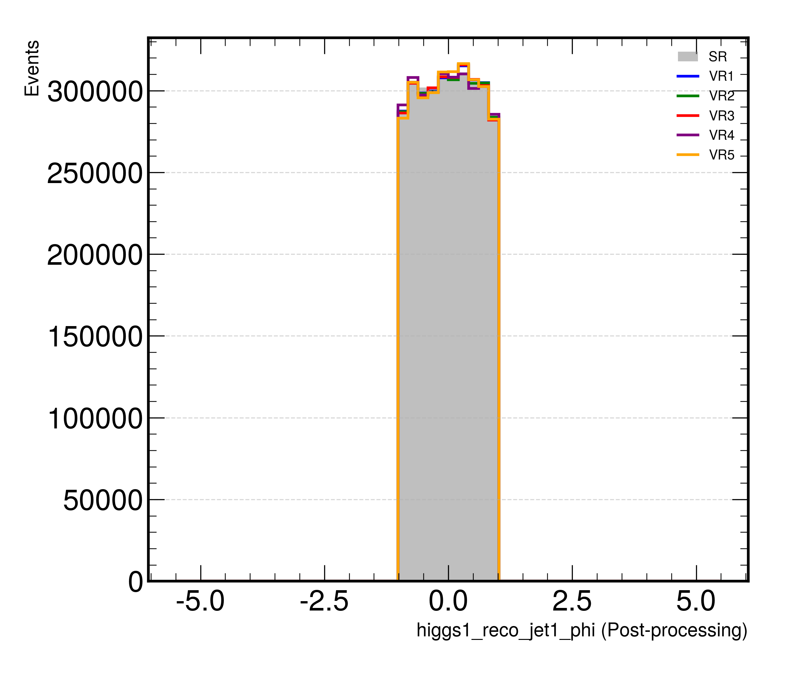<br>
  <em>φ of the leading jet of H₁ after scaling: a flat distribution with sharp edges.</em>
</p>

### Transfer learning to 4b data

The 4b regions hold about 100× fewer events than 2b (~20k per region), which is far too few for a model with about
1M parameters. The CNF is trained **only on 2b data** and applied unchanged to 4b. This mirrors the transfer-learning
logic of the background estimate itself, and keeps the SR⁴ᵇ completely unused. It works because the jj bb̄ and bb̄bb̄
QCD kinematics are very similar. The main difference is a shift to higher p_T in 4b, caused by the p_T dependence of
the b-tagging efficiency, and it is most visible in H_T. The flow never sees this shift in training, which explains
the residual mismodeling in the 4b p_T turn-on and tails.

### 5th jet

The 5th jet is relevant against tt̄, but its four-vector is undefined in 4-jet events. Padding would create
δ-peaks, which give singular Jacobians and a diverging training, and the 4-jet and ≥5-jet topologies also differ
physically. Two flows are therefore trained:

- **CNF_tot**: 17 features, all events. It provides the 42 features that do not depend on the 5th jet.
- **CNF_5j**: 21 features, events with n_jet ≥ 5. It provides the 10 features involving the 5th jet.

<p align="center">
  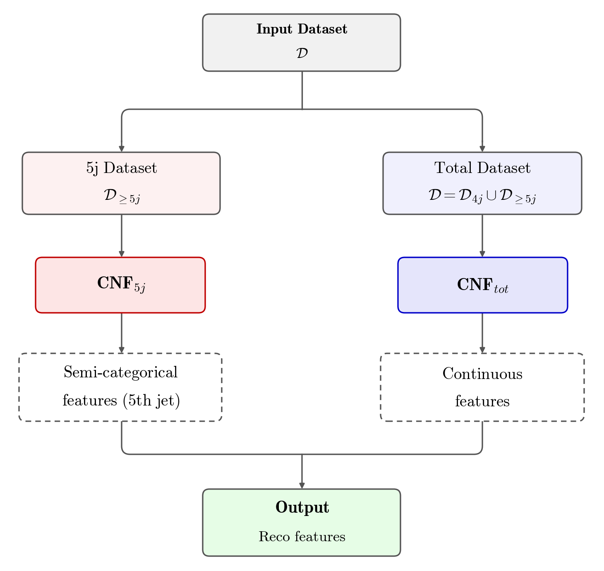<br>
  <em>Combined reconstruction strategy: 52 high-level features in total.</em>
</p>

### Overall network

The density is factorized as

```
p(D | c) = p(D_kin | c, D_φ) · p(D_φ | c)
```

- an **NCSF** over the 4 φ's, conditioned on c;
- an **NSF** over the 13 remaining features (p_T, η, m, H_T), conditioned on c and on the φ's.

|                     | NCSF     | NSF        |
|---------------------|----------|------------|
| features            | 4 (φ)    | 13         |
| context             | c        | c, φ       |
| transforms / bins   | 4 / 20   | 4 / 20     |
| hidden layers       | [64, 64] | [256, 256] |
| trainable params    | ~80k     | ~1.07M     |

Both blocks are masked autoregressive flows with monotonic RQS transforms, implemented with
[Zuko](https://github.com/probabilists/zuko). Training minimizes the NLL with AdamW and a cosine LR schedule with
warm-up, on a 75/25 train/validation split of 2b data.

<p align="center">
  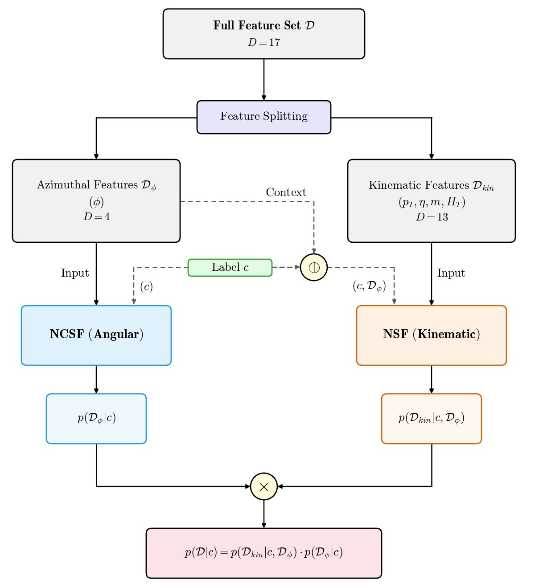<br>
  <em>CNF architecture.</em>
</p>

---

## 4. Uncertainty estimation: SWAG

The transport is deterministic, so it needs its own model (epistemic) uncertainty. This is estimated with
**Stochastic Weight Averaging-Gaussian (SWAG)**:

1. After convergence, training continues for T = 20 extra epochs at a constant LR (10⁻⁵), so the weights θᵢ wander
   around the minimum of the loss.
2. A Gaussian posterior N(θ_SWA, Σ_SWAG) is fitted to the recorded weights. Its mean is θ_SWA, the average of the
   θᵢ. Its covariance Σ_SWAG = ½(Σ_diag + Σ_low-rank) combines the per-weight variances with a low-rank term built
   from the deviations of the θᵢ, which captures correlations between weights.
3. S = 30 weight configurations are sampled from the posterior, and the events are transported once with each.
   The spread of the S transported values gives a **per-event variance** for every jet feature.


The variances are propagated to the high-level features to first order, Var f = Σᵢ (∂f/∂xᵢ)² Var xᵢ, with numerical
derivatives. In each bin, the result is combined in quadrature with the statistical uncertainty:

```
σ_tot = √(σ²_SWAG + σ²_stat)
```

SWAG is run only for the 2b model. The relative per-bin uncertainty measured in 2b is reused for the 4b transport.

---

## 5. Results

Agreement is quantified with the KL divergence and the KS statistic between transported and target distributions.
The heuristic acceptance thresholds are KL < 0.003 and KS < 0.03.

**2b closure:** VR²ᵇ → ŜR²ᵇ vs SR²ᵇ. The plots below use m_HH, which the network never sees.

<p align="center">
  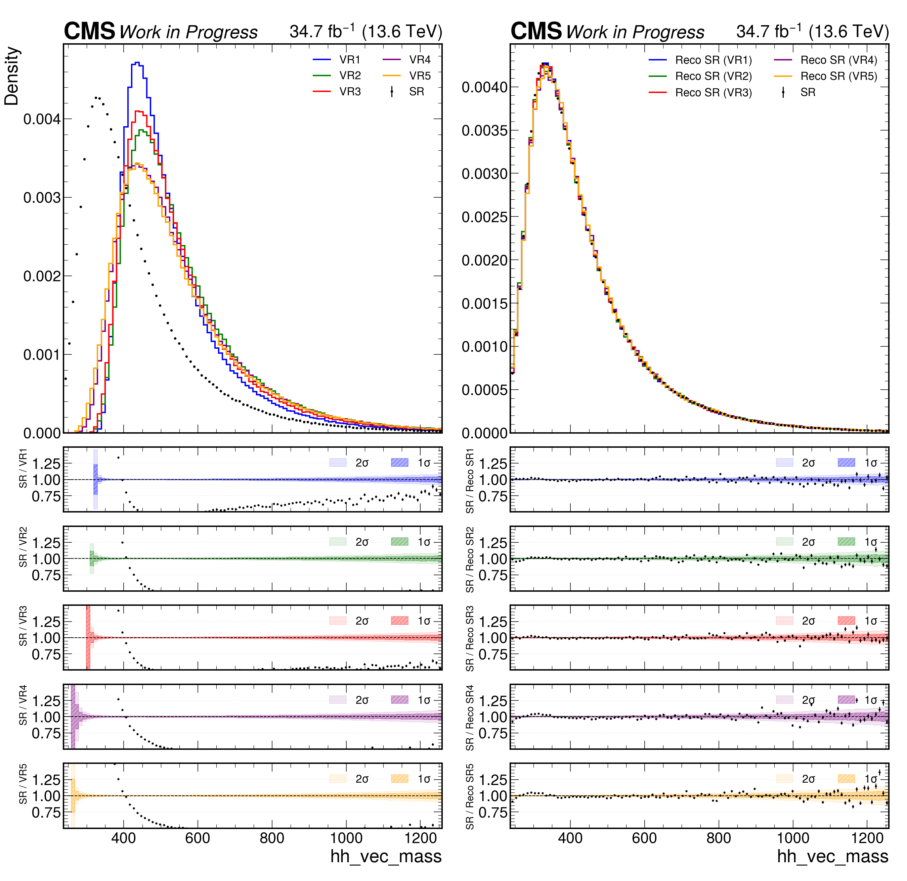<br>
  <em>m_HH: VRs²ᵇ before (left) and after (right) the transport, compared with SR²ᵇ. Bands: 1σ / 2σ (SWAG ⊕ stat.).</em>
</p>

**Final 4b comparison.** Lines show VR²ᵇ → ŜR²ᵇ (CNF) → S̃R⁴ᵇ (SvsB reweight). Markers show VR⁴ᵇ → ŜR⁴ᵇ (CNF). The
gray histogram is the true SR⁴ᵇ.

<p align="center">
  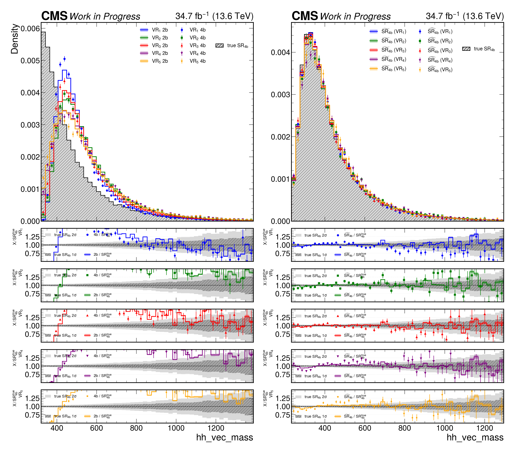<br>
  <em>m_HH in 4b, before (left) and after (right) the transport.</em>
</p>

<p align="center">
  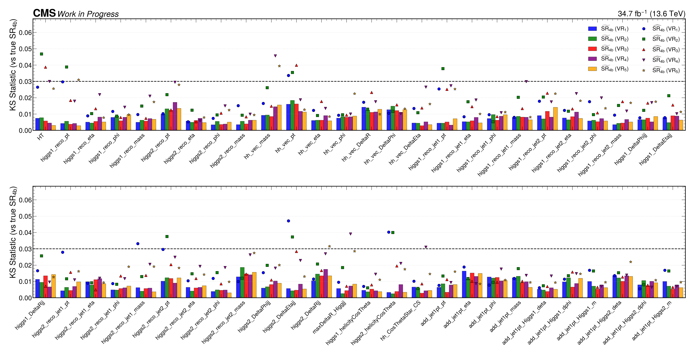<br>
  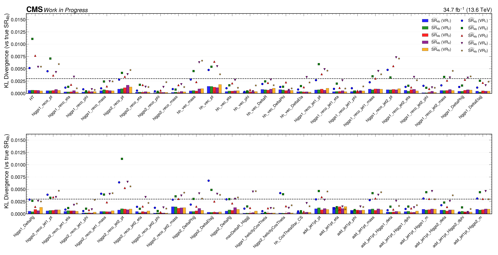<br>
  <em>KS (top) and KL (bottom) with respect to the true SR⁴ᵇ, for all features and all VRs. Bars: S̃R⁴ᵇ; markers: ŜR⁴ᵇ.</em>
</p>

- **2b:** excellent closure in all five VRs, for both the input features and the high-level features, including their
  correlations (checked with corner plots). VR₄ and VR₅, the farthest from the SR, are slightly worse.
- **4b:** the 2b-trained flow extrapolates well and clearly improves on the uncorrected VRs. The full
  CNF + SvsB-reweight chain agrees with the true SR⁴ᵇ for essentially all features. The residual deviations, in
  p_T^HH at low p_T and in some H_T and p_T tails, follow from the 2b/4b kinematic bias and the limited 4b statistics.

---

## 6. One flow for all the validation regions

The five VRs do not need five flows. A **single CNF** with the same architecture can be conditioned on a one-hot region
label, c ∈ {VR₁, …, VR₅, SR} (6 values instead of the binary VR/SR label), and trained once on the 2b events of all
five VRs plus as many SR events. The transport of VRᵢ uses c = VRᵢ → c = SR, so every VR goes through the same latent
space. Everything else is unchanged: 2b-only training, transfer to 4b, SWAG, high-level features (`NF/main_allVRs.py`).

It reaches **the same performance as one flow per VR**. The table compares, for all 52 high-level features
(42 from CNF_tot + 10 from CNF_5j, never seen by the networks), the transported VRs with the SR, averaged over the
five VRs (same binning and metrics as `Total/`):

| | KS mean | KS max | features with KS < 0.03 | KL mean | features with KL < 0.003 |
|---|---|---|---|---|---|
| **2b**, before the transport        | 0.097  | 0.61  | 35%  | 0.096   | 30%  |
| **2b**, one flow per VR             | 0.0041 | 0.021 | 100% | 0.00023 | 100% |
| **2b**, one flow for all the VRs    | 0.0028 | 0.009 | 100% | 0.00012 | 100% |
| **4b**, before the transport        | 0.097  | 0.60  | 35%  | 0.084   | 27%  |
| **4b**, one flow per VR             | 0.016  | 0.048 | 93%  | 0.0025  | 67%  |
| **4b**, one flow for all the VRs    | 0.014  | 0.040 | 94%  | 0.0018  | 85%  |

- The mean KS and the mean KL are lower with the single flow in every VR, in 2b and in 4b. In 2b the largest gain is
  in the farthest regions (worst KS 0.021 → 0.009 in VR₅); in 4b the two approaches are equivalent within the
  limited statistics (per VR, the fraction of features with KS < 0.03 and the worst KS fluctuate by a few percent
  either way).
- One model replaces five: ~1.15M parameters instead of ~5.8M, a single training, a single SWAG state and a single
  scaler for all the VRs. The regions share what they have in common, and the training sample is ~5× larger.
- Caveat: the per-VR flows were trained for 100 epochs, the single flow for 500 (both with early stopping on the
  validation loss and the same cosine schedule). Per epoch the single flow sees the events of all five VRs, so its
  training cost is ~5× that of the five per-VR trainings together (~3.5 days on one GPU for CNF_tot).

Since there is one training, the plots that are common to all the VRs (loss, log|det J|, learning rate, and the
feature importance of all the VRs in one figure) are in `<group>/{2b,4b}/training_diagnostic/` instead of being
repeated in every VR folder.

---

## 7. Implementation

### Pipeline

1. **Train** the CNF on 2b VRᵢ vs SR, separately for each VR (`main.py`), or once for all the VRs (`main_allVRs.py`).
2. **Transport** VR → SR in 2b, and in 4b with the same 2b model.
3. **SWAG**: per-event uncertainty on the transported jets.
4. **High-level features**: rebuilt from the transported jets, with first-order variance propagation. An optional
   small flow-matching model corrects the tail of `minDeltaR_Higgjj` (`--include_min_dr`).
5. **Final 4b estimate**: an FFN trained in the CR estimates the 2b → 4b likelihood ratio and reweights the
   transported 2b VRs (S̃R⁴ᵇ), which are then compared with the transported 4b VRs (ŜR⁴ᵇ) and with the true SR⁴ᵇ.

### Repository structure

```
HH4b_final_code/
├── lib/                          general tools, independent of the model
│   ├── data_loader.py                data loading (ROOT), preprocessing, PyTorch datasets
│   ├── data_loader_allVRs.py         training sample of the all-VR flow (one-hot region condition)
│   ├── features.py                   lists of input and high-level features
│   ├── metrics.py                    histograms with uncertainties, KL, KS, χ²
│   └── visualization.py              all plotting functions (CMS style)
├── NF/                           normalizing-flow code
│   ├── model.py                      the CNF (NCSF + NSF), training and transport
│   ├── model_allVRs.py               the same CNF with the one-hot region condition (all the VRs)
│   ├── test_model.py                 checks: VR/SR classification, feature importance, latent-space normality
│   ├── swag.py                       SWAG uncertainty
│   ├── features_reconstruction.py    high-level features from the transported jets + variance propagation
│   ├── minDeltaR_error.py            flow-matching correction of minΔR_jj
│   ├── ffn.py                        2b → 4b likelihood-ratio FFN
│   ├── evaluation.py                 per-VR and all-VR comparisons, metric summaries, corner plots
│   ├── utils.py                      output paths and file I/O
│   ├── main.py                       ENTRY POINT: full pipeline, one flow per VR (4-jet, or 5-jet with --jet5)
│   ├── main_allVRs.py                ENTRY POINT: full pipeline, one flow for all the VRs
│   └── final4b_evaluation.py         ENTRY POINT: FFN + final 4b comparison
├── run_training.sh               HTCondor executable (CMSML container)
├── train_job.sub                 HTCondor submit file (one flow per VR)
└── train_job_allVRs.sub          HTCondor submit file (one flow for all the VRs)
```

`lib` never imports from `NF`.

### Requirements

`torch`, `zuko`, `mplhep`, `uproot`, `vector`, `scikit-learn`, `h5py`. All of them are in the CMSML container
(`/cvmfs/unpacked.cern.ch/registry.hub.docker.com/cmsml/cmsml:latest`) except `vector`, which `run_training.sh`
installs.

### Running

```bash
python NF/main.py                     # 4-jet model (CNF_tot), all events  -> <base_path>/All/
python NF/main.py --jet5              # 5-jet model (CNF_5j), njet >= 5    -> <base_path>/5jet/
python NF/final4b_evaluation.py       # FFN (trained if missing) + final 4b comparison

python NF/main_allVRs.py              # one flow for all the VRs, 4-jet   -> NF_model_allVRs/All/
python NF/main_allVRs.py --jet5       # one flow for all the VRs, 5-jet   -> NF_model_allVRs/5jet/
python NF/main_allVRs.py --steps global final4b   # Total/ and Total/evaluation/ (when both groups are done)
```

`main.py` and `main_allVRs.py` run the steps selected with `--steps` for each VR:

| step        | what it does |
|-------------|--------------|
| `train`     | trains the flow on 2b VRᵢ vs SR (all-VR model: once, on all the VRs + SR) |
| `tests`     | VR/SR classification with the flow likelihood ratio, feature importance |
| `transport` | VR → SR transport (2b, and 4b with the 2b flow), latent-space checks |
| `swag`      | SWAG uncertainty of the transport |
| `hlf`       | high-level feature reconstruction and comparison with the SR |
| `global`    | all-VR plots (`Total/`, 4-jet and 5-jet features) and corner plots of both groups |
| `final4b`   | final 4b comparison with the FFN reweight (`Total/evaluation/`), as `final4b_evaluation.py` |

`global` and `final4b` combine the 4-jet and the 5-jet results: run them when both pipelines are done.

Examples:

```bash
python NF/main.py --regions 1 2 --steps train transport   # only VR1 and VR2
python NF/main.py --steps hlf global --include_min_dr
python NF/final4b_evaluation.py --retrain_ffn
```

Results already on disk (models, scalers, SWAG states, evaluations) are reused. They are recomputed only on request,
with `--retrain`, `--retrain_swag`, `--recompute_eval`, `--retrain_mdr` or `--retrain_ffn`. `--help` lists all
options.

**HTCondor (GPU):** `mkdir -p logs && condor_submit train_job.sub` queues the 4-jet and 5-jet pipelines. When both
are done, uncomment the `final4b` line and submit again. For the all-VR flow use `train_job_allVRs.sub`, then the
second queue block (`--steps global final4b`).

### Output layout

```
<base_path>/
├── All/ , 5jet/
│   ├── VR<i>_vs_SR_result/   2b: weights/ (flow, scaler, SWAG), eval_data/ (h5), plots/
│   └── VR<i>_4b/             4b: same structure, without weights
├── Total/{2b,4b}/            all-VR comparison; Total/evaluation/ = final 4b comparison
└── corner/<group>/{2b,4b}/
<ffn_base_path>/{All,5jet}/{CR,SR}/   FFN weights, closure plots, SR weights

NF_model_allVRs/                (one flow for all the VRs)
├── All/ , 5jet/
│   ├── weights/                    flow, scaler, training history, SWAG state (shared by all the VRs)
│   └── 2b/ , 4b/
│       ├── training_diagnostic/    loss, log|det J|, learning rate (lin / log), feature importance of all the VRs
│       └── VR<i>/                  eval_data/ (h5), plots/
├── Total/{2b,4b,evaluation}/
└── corner/<group>/{2b,4b}/
```

Each `plots/` folder contains `classification/` (confusion matrices, ROC, likelihood-ratio distribution),
`latent_space_comparison/` (`distribution/`, `scatter/`, `latent_normality/` + summaries) and `hlf_comparison/`
(`distribution/`, `scatter/` + summaries); the per-VR model also has its training plots and feature importance there.

### Notes

- The 2b training sample contains all VR events and the same number of SR events (subset or bootstrap), so the two
  classes are balanced. The evaluation uses the original, non-resampled events.
- The 5-jet model applies the n_jet ≥ 5 selection consistently in training, evaluation, the true SR⁴ᵇ and its FFN.
